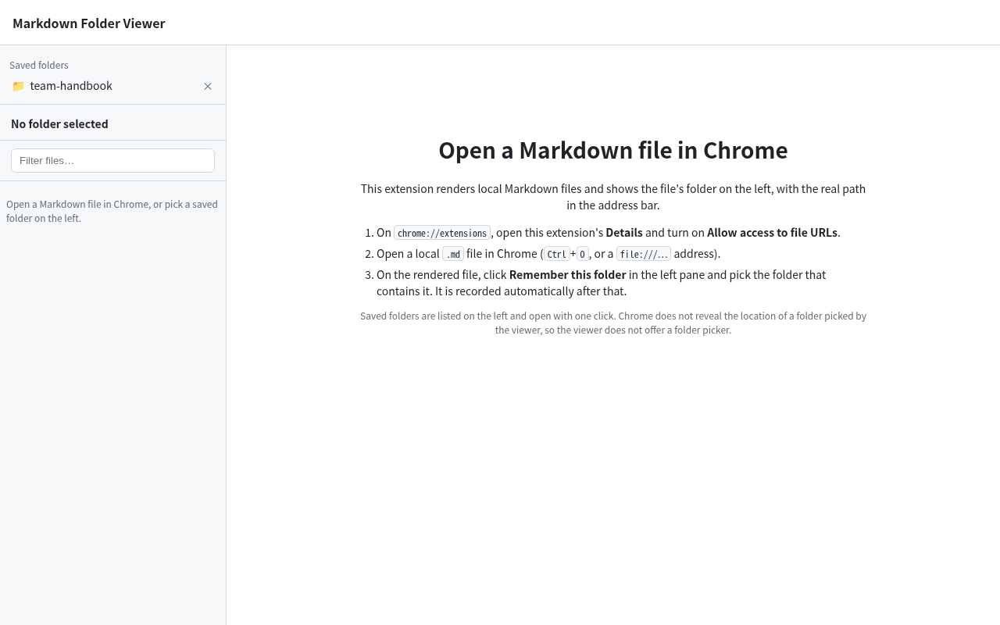
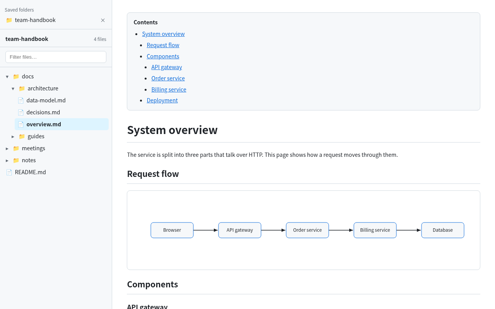
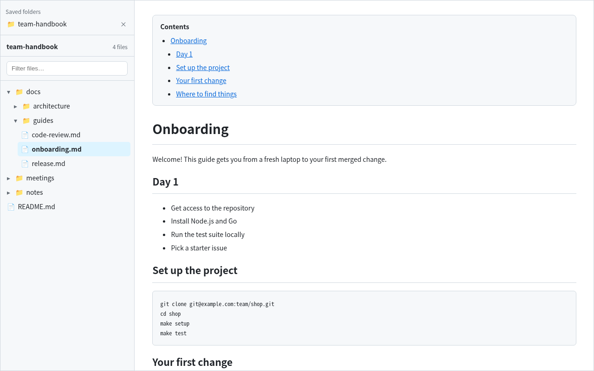
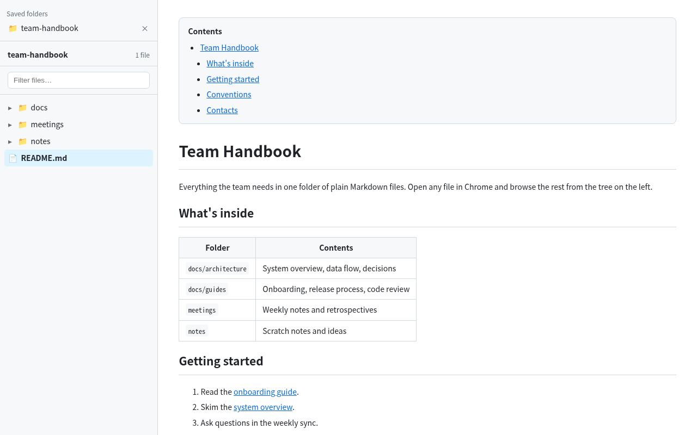
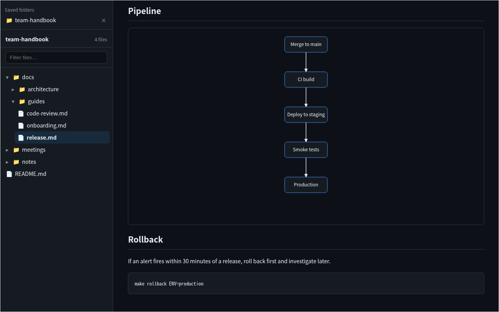

# Markdown Folder Viewer

A local-only Chrome extension (Manifest V3) for browsing Markdown files under a user-selected folder. It includes a lazily loaded folder tree, file filtering, a table of contents, relative `.md` links, relative image paths, and a **small built-in Mermaid flowchart subset renderer**.

## Screenshots

<details>
<summary>Start page — saved folders and how to open a local Markdown file</summary>



</details>

<details>
<summary>Folder tree, table of contents, and built-in Mermaid flowcharts</summary>



</details>

<details>
<summary>First-time "Remember this folder" flow</summary>



</details>

<details>
<summary>Top-level README.md as the folder landing page</summary>



</details>

<details>
<summary>Dark theme</summary>



</details>

## Install
1. Extract the ZIP to a folder.
2. Open `chrome://extensions` in Chrome.
3. Enable **Developer mode**.
4. Click **Load unpacked** and select this folder (the folder containing `manifest.json`).
5. Open the extension's **Details** and turn on **Allow access to file URLs**.
6. Open any local `.md` file in Chrome. It is rendered with the folder tree on the left, and the address bar shows the real file path.

Requires Chrome 88 or newer (the Chrome Web Store minimum for Manifest V3).

### Starting from a Markdown file
The main entry point is a `file://` Markdown page, such as `file:///home/me/notes/README.md`, because that is the only way Chrome reveals the folder's disk location. The first time, click **Remember this folder** in the left pane and pick the folder that contains the open file (its own folder or any folder above it). Chrome does not allow a picker inside the pane, so a small window opens for this.

Chrome reveals only a picked folder's name, not its location, so the pane takes the location from the open file's path and records the folder automatically once it has confirmed that the folder really contains the open file. Saved folders are listed in the pane and open with one click; opening any file under a saved folder from the address bar also switches the tree to it. When the current folder already contains the open file, **Remember this folder** saves the file's parent folder without a picker; after the first visit no extra click is needed. Clicking a file in the tree navigates the tab to that file's `file://` URL, so the address bar shows the real path. This also applies when the viewer is opened normally (for example from the toolbar popup), because the folder's location has already been learned. Expanded folders are remembered across navigations.

### Toolbar popup
**Open viewer** opens a start page that lists saved folders (and the last used folder) and explains how to open a Markdown file. It deliberately offers no folder picker: Chrome never reveals the location of a folder picked there, so the folder could neither be saved with its path nor open files as `file://` pages. To add a folder, open a Markdown file from it in Chrome once; it is recorded automatically after that.

## Development
```bash
npm test              # renderer tests (node --test) plus the browser security tests
npm run test:dom      # browser tests only (needs Chrome/Chromium; CI: REQUIRE_DOM=1)
npm run icons         # regenerate icons/icon{16,48,128}.png and store/icon128.png from tools/make-icons.mjs
npm run package       # build dist/markdown-folder-viewer-<version>.zip for the Chrome Web Store
npm run verify-package  # fail if that ZIP no longer matches the working tree
```
`npm test` runs the dependency-free Markdown tests under `node --test` and then
`test/dom/sanitize.html` and `test/dom/page.html` in headless Chrome. Together
they cover the security-critical `sanitize()` path (raw HTML, mutation-XSS
vectors, URL policy, attribute policy) and the file:// content script end to end
(escaped HTML, external link hardening, sidebar iframe nonce).
The browser half needs a real DOM, so it cannot run under `node --test`; it is
skipped with a notice when no Chrome/Chromium is installed. Set
`CHROME=/path/to/chrome` to point at a specific binary, or `REQUIRE_DOM=1` to
fail instead of skipping (recommended in CI).

Chrome does not accept SVG for manifest icons, so the PNGs are generated from the
same shapes as `icons/icon.svg` by a dependency-free Node script. Re-run
`npm run icons` after changing the design.

`store/icon128.png` is the Chrome Web Store listing icon ("Store icon"): the same
artwork at 96x96 with 16px of transparent padding, as the store's image guidelines
recommend. Upload it on the store listing page; it is not part of the ZIP.
`store/screenshots/` holds the listing screenshots (1280x800, 24-bit PNG without alpha).
Re-run `npm run screenshots` after replacing those PNGs to draw the 1px `#d0d7de` edge
used in the README on GitHub (baked into the image, not added by CSS).

## Notes / limitations
- The extension has no host permissions and makes no network requests. Markdown rendering and sanitization are implemented locally in `markdown.js`.
- To keep the package self-contained and offline, the Markdown parser is a lightweight built-in renderer rather than the full CommonMark specification. It supports headings (ATX and setext), paragraphs, emphasis, strikethrough (`~~text~~`), inline code, fenced code blocks, links, images, blockquotes, lists, horizontal rules, and basic pipe tables. Nested lists are flattened to a single level. Raw HTML in source files is escaped rather than rendered, with two exceptions: `<details>` / `<summary>` blocks (including `<details open>`) become collapsible sections, and HTML comments are hidden.
- The Mermaid renderer currently supports simple `flowchart` / `graph` diagrams with `TD`, `TB`, `LR`, `RL`, and `BT` direction and basic node/edge syntax. It is not the full Mermaid engine; advanced Mermaid syntax is shown as source code instead of being rendered.
- Folder handles are saved in IndexedDB. After a browser restart Chrome usually needs permission again; the viewer offers a **Grant access** button so you do not have to re-pick the folder. If that fails, open a file from the folder in Chrome again.
- Folders start collapsed and are scanned lazily: the initial load reads only the top level, and expanding a folder scans just that folder's direct children. Opening a relative link to a file in an unopened folder still works. The file counter reflects the levels loaded so far.
- The generated table of contents (**Contents**) starts collapsed; click it to expand.
- The current document is preserved when you switch files.
- The address bar shows the open file's absolute path (`file:///…`) whenever the folder's disk location is known. Chrome's folder picker never reveals that location, and no Chrome API exposes it, so folders are only added by opening one of their Markdown files in Chrome. A folder whose location is still unknown (for example the last used folder after a failed pick) opens inside the viewer with a relative `?file=` URL.
- On first open, the viewer shows the top-level `README.md` so the folder's landing page appears instead of the alphabetically first file. If there is no top-level README, the first top-level Markdown file is shown.
- Relative Markdown links are resolved inside the selected folder. Remote HTTP(S) links open in a new tab. Relative images are read from the selected folder; images with an absolute URL (including `//host` paths) are not loaded and appear as links instead, so opening a file makes no network request.
- This extension is read-only; it does not modify local files.

## Security
Rendered Markdown HTML is sanitized against an explicit allowlist of tags and
per-element attributes. Script-capable tags, event-handler attributes, `id` on
anything but headings (no DOM clobbering) and unexpected `class` values are
removed. Source HTML is escaped by the renderer itself, so raw HTML never reaches
the DOM; the sanitizer is the second line of defence and both paths are covered
by `test/dom/sanitize.html`.

URLs use an allowlist rather than a deny list. Links may be relative or use
`http:`, `https:`, `mailto:` or `tel:`; `javascript:`, `vbscript:`, `data:`,
`file:`, `blob:`, `filesystem:`, `chrome:` and `chrome-extension:` are dropped.
Control characters are stripped from URLs before the check, since browsers
ignore them when parsing. Images may only be folder-relative, so opening a file
never fetches anything from the network: an image with an absolute URL is shown
as an ordinary link, and nothing leaves the device until the reader clicks it.
External links use `rel="noopener noreferrer"`.

The extension has no host permissions and makes no network requests of its own;
the CSP in `manifest.json` also pins `object-src` off. Very deeply nested
`<details>` or `>` blocks are capped so a crafted file cannot overflow the stack.
